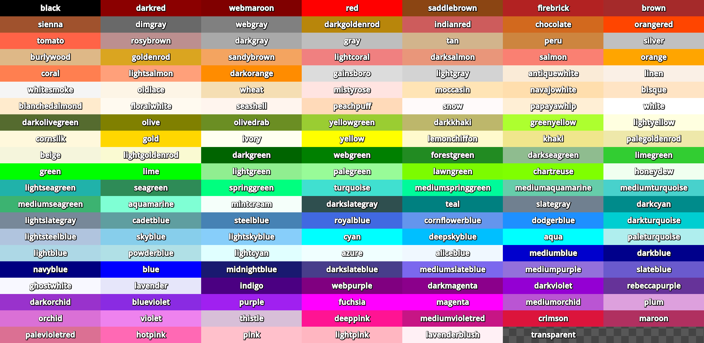

# godolors :art:

Generates a preview of Godot color constants.

https://docs.godotengine.org/en/stable/classes/class_color.html

## Table of Contents

- [Table of Contents](#table-of-contents)
- [Usage](#usage)
- [Update Colors](#update-colors)

## Usage

- Run Godot project
- Or run headless through docker: `docker build --output out .`

Old version built with Godot 3 is available in the [`godot-3` branch](https://github.com/theowiik/godolors/tree/godot-3).

## Update Colors

*Last updated 2023-11-30 for Godot 4.2*

Update `_INPUT_COLORS_HERE.txt` with the colors from the Godot Documentation: https://docs.godotengine.org/en/stable/classes/class_color.html
